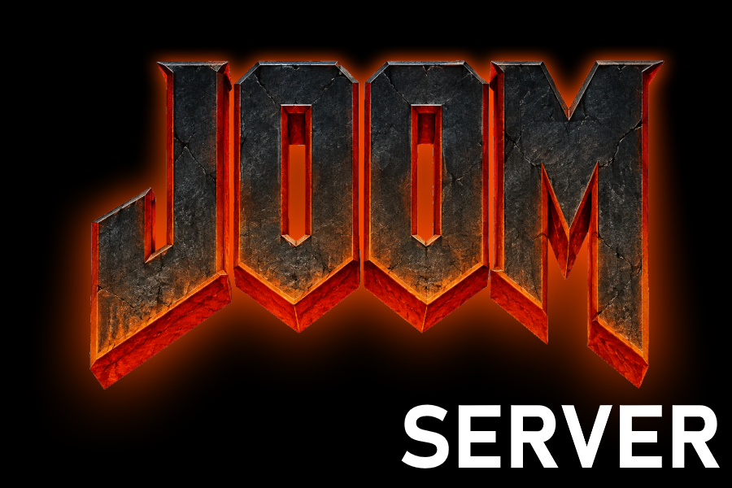

# JOOM Source

Исходный код игрового сервера игры JOOM.

## Требования

Для запуска требуется **Java 25**.

Скачать требуемую версию **Java 25** можно на официальном сайте [ORACLE](https://www.oracle.com/java/technologies/downloads/#java25).

Проверить установленную версию можно командой:

```bash
java -version
```

Также нужно установить и настроить **mySQL**.

Создание базы в **mySQL**.

```mysql
CREATE DATABASE IF NOT EXISTS game_server CHARACTER SET utf8mb4 COLLATE utf8mb4_unicode_ci;
CREATE USER IF NOT EXISTS 'game'@'localhost' IDENTIFIED BY 'admin123!';
GRANT ALL PRIVILEGES ON game_server.* TO 'game'@'localhost';
FLUSH PRIVILEGES;
EXIT;
```

Настройка admin_config.properties

```properties
# ============================================
#  Настройки админ-панели игрового сервера
# ============================================

# Порт веб-интерфейса админ-панели
admin.port=8090

# Пароль администратора (ОБЯЗАТЕЛЬНО смените!)
admin.password=admin123!

# Публичный URL админки — он подставляется в ссылку скачивания карты,
# которую получает клиент. Укажите внешний IP сервера.
admin.public-url=http://127.0.0.1:8090

# Папка для хранения загруженных карт (.slop)
maps.dir=maps

# Папка с файлом интерфейса admin.html
web.dir=web

# ============================================
#  Подключение к MySQL
# ============================================
db.host=localhost
db.port=3306
db.name=game_server
db.user=root

#пароль от бд game_server
db.password=admin123!

# ============================================
#  Игровые настройки (можно менять в админ-панели)
# ============================================
# Минимум готовых игроков для автостарта матча (1-8)
game.min-players-start=2
# Максимум игроков на сервере (2-64)
game.max-players=16
# Длительность матча в секундах (30-7200)
game.match-duration=180
```

## Запуск

1. Скачайте последний билд из раздела [Releases](https://github.com/VERTEXSoftware/JoomClient/archive/refs/heads/main.zip).
2. Распакуйте архив в удобную папку.
3. Соберите проект.
4. Переместите папку **web** к **jar** файлу.
5. Запустите сервер одним из способов:

**Linux / macOS:**

```bash
./start.sh
```

**Windows:**

```bat
start.bat
```

Либо напрямую через Java:

```bash
java -jar gameserver.jar
```
